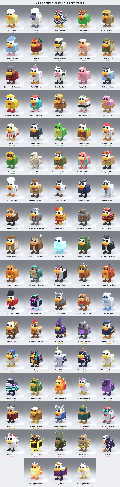

# Chicken roster expansion — 83 new models (October 15, 2026)

This is an art package of real rigged Blender models, built through Blender MCP. Nothing here has
been imported into Studio, uploaded, added to `PetCatalog`/`ChickenAppearanceAssets`, saved to
Roblox or published.

The design list is in `docs/team/CHICKEN_ROSTER_EXPANSION.md` and the effect design is in
`docs/team/CHICKEN_ROSTER_VFX_PLAN.md`.

## Contents

| Path | What |
|---|---|
| `Chicken-Roster-Expansion.blend` | One scene per chicken, named `Roster_<ID>`. Each holds a copy of the rig, a copy of the skin and one fitted prop mesh. Textures are packed. The approved source scenes from `Chicken-Expansion-v1.blend` are kept unchanged for continuity. |
| `models/<ID>.glb` | Animated GLB with embedded textures and exactly six clips: `Chicken_Idle`, `Chicken_Walk`, `Chicken_Peck`, `Chicken_Hit`, `Chicken_Defeat`, `Chicken_Celebrate`. |
| `models/<ID>-Bind.fbx` | Bind-pose FBX with embedded textures (no animation). |
| `textures/` | 512×512 pixel atlases (`<ID>-base-color.png`), plus `<ID>-emission.png` where a chicken glows. Use nearest filtering. |
| `previews/` | `<ID>.jpg` is the real model render. `<ID>-Chicken_Walk/Peck/Celebrate.jpg` are action-pose checks. |
| `concepts/` | One generated reference per chicken (`chatgpt-image`, edited from the approved base render). Prompts are in `source/ref_prompts.json`. |
| `batches/` | Labeled lineups and per-batch manifests (batches 0–9). |
| `manifest.json` | All 83 entries: name, rarity, strength band, zone, earn path, files, triangles and VFX sketch. |
| `export-review.json` | Independent GLB/FBX check written by `source/verify_exports.py` (run without Blender). |
| `source/` | `lib.py` (build, render, export, review), `pal.py` (paint helpers), `b0.py`–`b9.py` (the chicken specs), `lineup.py`, `verify_exports.py`. |

The full-resolution PNG renders and references live in the Blender staging folder
`~/.codex/artifacts/chicken-roster-expansion-20261015/`. The repo copies are compressed JPGs.

## How each chicken was made

1. A reference image is generated from the approved base-chicken render, and the palette is
   set in code.
2. The approved `Chicken_Master_Rig` and `Chicken_Skin` are copied into a new `Roster_<ID>`
   scene.
3. A new pixel atlas is painted per face of the skin. The UVs are re-laid; the geometry,
   proportions and weights are not touched.
4. Accessories are rigid cuboids, each weighted 100% to one existing bone (Head, Body, Beak,
   Wattle, Wing_L/R, Leg/Foot, Neck), and gathered into one `Roster_<ID>_Props` mesh.
5. The model is rendered at rest, then in the Walk, Peck and Celebrate poses.
6. Export and review.

## Rig and export contract (checked for all 83)

- The 168 base skin vertices are unchanged (max position delta 0). No vertex is unweighted.
- 18 joints per skin. Every mesh primitive has `JOINTS_0`/`WEIGHTS_0`.
- Exactly the six allowed clips, each with channels.
- Embedded images in every GLB. The bind FBX is present.
- No preview objects in any export (`FX_*` glow cubes, studio lights, backdrop, camera,
  labels).
- Blender coordinates: +Z up, facing −Y, origin at foot level. There is no new size
  multiplier; the game keeps its own display scale.
- Triangle counts: the base skin is 252 triangles. With props, chickens range from 252 to
  about 1,300 triangles (the per-chicken value is in `manifest.json`).

`export-review.json`: **83 checked, all OK.**

## The 83

| Batch | Chickens |
|---|---|
| 0 Halloween | Pumpkin (remake of the existing `Pumpkin` catalog ID), Witch, Animatronic, Zombie Hunter, Mummy, Vampire |
| 1 Thin rarities + chase | Hatchling, Silkie, Speckled Hen, Bacon Hair Chick, Phoenix, Unicorn, Kraken, The First Hen, Rift Walker, Supernova |
| 2 Zone chickens | Crate Runner, Miner, Paratrooper, Coral Reef, Castle Guard, Court Jester, Ironbeak, Deepsea Diver, Dragon Hatchling, Royal Guard |
| 3 Legendary/Mythic | Geode, Airship Captain, Dragon Knight, Pharaoh, Stained Glass, Moon, Time Keeper, Mecha, Kitsune Spirit |
| 4 Common/Uncommon | Scarecrow, Pajama, Lumberjack, Party, Cow, Piggy, Sushi, Donut, Popcorn, Gamer, Frog |
| 5 Rare/Epic | Firefighter, Chef, Detective, Samurai, Cowboy, Steampunk Scratcher, Neon, Norse Raider |
| 6 Specials | Gingerbread (Christmas), Firework (New Year), Kingslayer, Ascendant |
| 7 Round two (Common/Uncommon) | Rooster, Sheep, Plushie, Mailman, Raincoat, Skater, Taco, Painter, Sunflower, Snowman |
| 8 Round two (Rare/Epic/Legendary) | Police, Doctor, Ghost, Archer, Rockstar, Yeti, Mimic, Gladiator, Olympian, Aurora |
| 9 Round two (Legendary/Mythic) | Jade, Griffin, Valkyrie, Eclipse, Forest Guardian |

**Originals, not copies:** Animatronic and Zombie Hunter are original designs inspired by
player requests. They use no third-party names or signature looks: the Animatronic is not
yellow and has no bib.

## Integration notes (for the later, coordinated Studio pass)

- Import each GLB as a new template under `ReplicatedStorage.PetRoll.ChickenAssets.<Name>`.
  Never replace an existing template.
- Bone names are unprefixed (`Body`, `Head`…). Follow the newer `ChickenAppearanceAssets`
  entries: `bonePrefix=""`, `unitScale=0.670163170`, `pivotRig=true`.
- `PetCatalog`: add one `variant(id, bandKey, name, weight, color)` per chicken. Use these
  band keys:

  | Band | Key |
  |---|---|
  | 1 | `Duck` |
  | 2 | `Mallard` |
  | 3 | `Chunky` |
  | 4 | `Bucket` |
  | 5 | `Viking` |
  | 6 | `Knight` |
  | 7 | `Wizard` |
  | 8 | `Dragon` |
  | 9 | `IceDuck` |
  | 10 | `StormDuck` |

  These are the original economy keys, which `variant()` clones before the October 7 remap.
  All of them are new IDs, so there is no save risk. Gingerbread, Firework, Kingslayer and
  Ascendant use zero weight, like Pumpkin. Kingslayer and Ascendant still need an owner
  decision on how they're earned.
- `Pumpkin` already exists in the catalog with a procedural fallback. Its template here
  replaces only that fallback.
- Every chicken still needs its black-stroke Index icon (AGENTS.md icon rule).
- The VFX are planned, not built. See `docs/team/CHICKEN_ROSTER_VFX_PLAN.md`. Props that need
  to move (clock hands, propeller, halo rings, gears) are separated at import.

## Rebuild

Open Blender with the staging copy of the approved master, then in Blender run:
`G={}; exec(open('<staging>/source/lib.py').read(), G); G['run_batch']('b3')`.

`run_batch` rebuilds, renders, exports, reviews and saves one batch. `lineup.py` and
`verify_exports.py` run with normal Python 3 (PIL for lineups).
