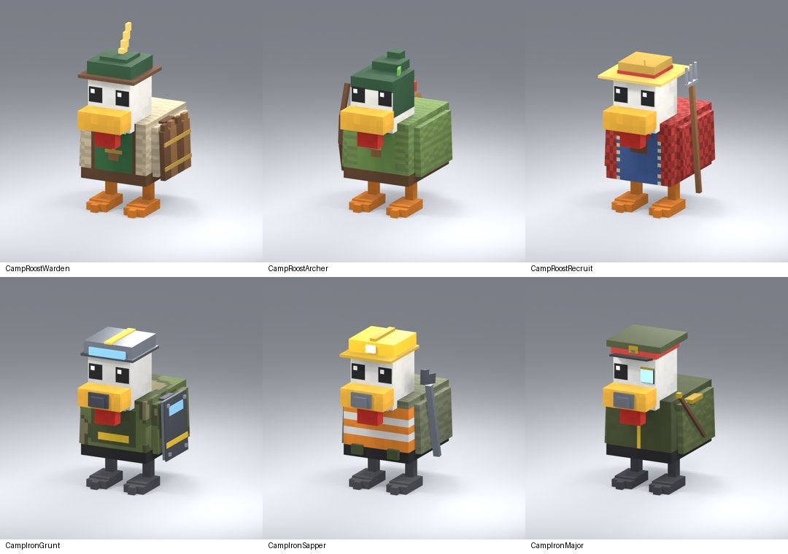

# Camp guards (October 26, 2026)

Stevin: "make unique chickens for each of the camps, like the random spawning areas ... the
Cluck Camp can just be the normal white chickens but the rest should be custom".

Cluck Camp keeps one basic Chicken (`Duck`). Fort Roost and Ironbeak HQ are guarded by six
enemy-only chickens built for them, like the Mission sites' Loyalists
(`LOYALIST_GUARDS.md`). Each copies the stats of the guard it replaced, so every camp fight
keeps its exact strength (`Rules.Power` 12 / 106 / 192, `tests/FoundationChecks`).

| Camp | Theme | Guards (stats of) |
|---|---|---|
| Fort Roost | frontier timber fort: pine green, timber, straw | Roost Warden (Robo-Cluck `Bucket`), Roost Archer (Mushroom `Sailor`), 2× Roost Recruit (Brown Chicken `Mallard`) |
| Ironbeak HQ | steel army base: olive drab, riveted iron, hazard yellow | 2× Ironbeak Grunt Lv 2 (`Bucket`), Ironbeak Sapper Lv 2 (`Sailor`), Ironbeak Major (Crystal `Viking`) |

- **Art:** `assets/camp-guards-20261026/` holds the spec (`source/c1.py`, built with the
  roster-expansion `lib.py`/`loyal.py` helpers in the Blender staging file
  `~/.codex/artifacts/chicken-roster-expansion-20261015/`), GLB+FBX, runtime meshes, previews,
  the Studio importer copy and the asset receipts.
- **Studio:** `ReplicatedStorage.PetRoll.ChickenAssets.Camp*`; staging copies in
  `ServerStorage.CampGuardsImport20261026`. Studio-owned: save the place to keep them.
- **Code:** `PetCatalog.CampGuards` (appended to `Loyalists`: enemy only, zero weight, never
  in `Order`, the Index or inventory), `ChickenAppearanceAssets`, `src/animations/Camp*.luau`
  and the rosters in `Progression.luau`. The King is unchanged.
- **Checks:** all six passed the export review (18 joints, six clips, no unweighted
  vertices); in a Studio playtest both camps spawned only these guards with their names.
  No effects and no portraits.
